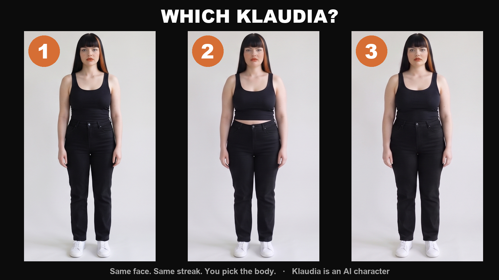
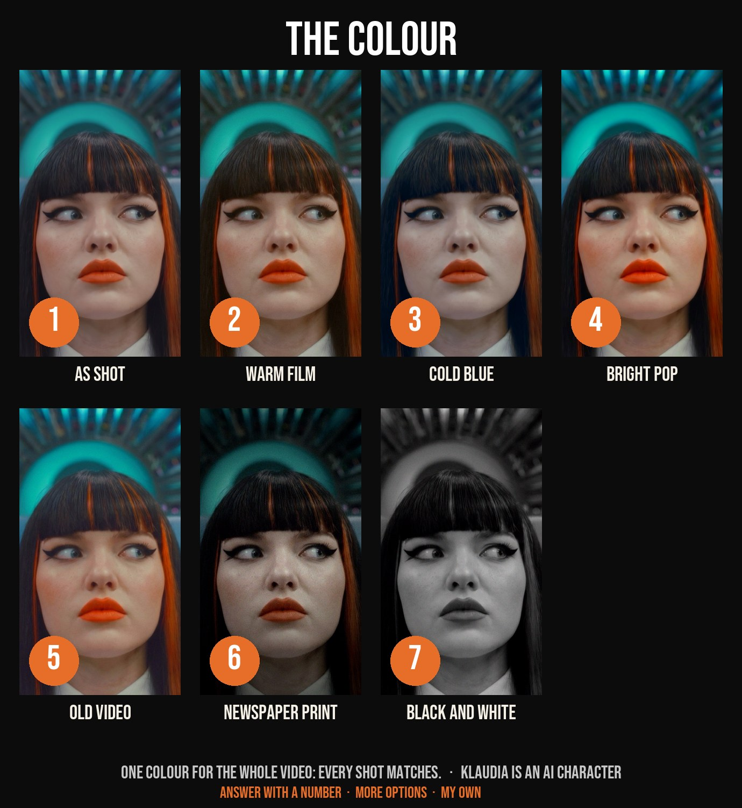

# KLAUDIA BOT

**Make videos with Klaudia in Grok Bot. You pick with pictures and numbers; she does the rest.**

| | |
|---|---|
| 📰 **Klaudia's News** | Send a news story (an X link is enough). She sings it in 30–40 s. |
| 💸 **Unpaid sponsorship** | Name a product you love. She makes the ad nobody paid for. |
| 🎵 **My song with Klaudia** | Your idea, lyric or song, with her as the singer (1–3 min). |
| ➕ **feat.** | Bring Claudia (the open character by anabology) or a character of your own. |

## How it feels
1. Send the news. Tap a hook.
2. Pick your Klaudia: **1 · 2 · 3**, her role, her clothes.
3. Say yes to the song (your Suno). Pick the take by ear.
4. While it sings: pick the **colour** and the **words** from two pictures.
5. See **the board** — every shot with its photo, second, line and graphic — plus **style frames** and a free preview. Change anything by number: "3: she dances".
6. One yes for all the clips. While they are made you already get the **thumbnail and the post**.
7. The video arrives **vertical and 16:9**.

## What you need
- **Grok Bot** (in your X plan).
- **Suno**, your own account, connected once (Suno's official connector).
- **OpenRouter**, pay as you go, with your own cap: her photos (about $0.14 each) and her singing (HeyGen, $0.05 a second). **About $1–3 a video.** The bot shows every price and waits for your yes.

## Install
Add the KLAUDIA BOT from its link and say **set me up**. Later, say **update**.
Manual: `git clone https://github.com/isidoro4/klaudia-bot /workspace/klaudia-bot && python3 -m pip install --user pillow imageio-ffmpeg numpy "opencv-python-headless<5"`.

## Why she always looks like Klaudia
Every photo of her is made with her face sheet as image 1 ("who she is"), her clothes as image 2 and the style as image 3, with the same words every time, and checked against a fixed list before you see it. Her singing is HeyGen animating that photo with her own voice, placed on the song to the frame, and measured: a take that drifts is cut before it does.

## Good to know
- **One chat per video**: the video lives in its folder; say "continue" in a new chat to pick it up.
- Nothing is posted by the bot. You post it.
- Rules: fan-made and labelled AI · no politics · nothing sexual · no real people's faces · no betting or investing ads, never a coin. [RULES.md](RULES.md)

## For the curious
| | |
|---|---|
| `skills/` | the bot's recipes, one per step: welcome, setup, news, sponsorship, music video, song, board, shots, lipsync, style, feat, edit, resume, update |
| `bin/` | the tools: `klaudia_board.py` (the board), `klaudia_photo.py` (her stills + review), `klaudia_sing.py` + `klaudia_sync.py` (singing + lip-sync check), `klaudia_edit.py` (the edit), `klaudia_graphics.py`, `klaudia_sheet.py` (pick-by-number sheets), `klaudia_social.py` (thumbnail + post), `klaudia_guest.py` (feat.) |
| `kit/` | who she is, her menus (roles, bodies, looks, sounds, dances, colours, words, graphics), the moulds and the fixed news board |
| `sheets/` | the example sheets you choose from |
| `refs/` | her reference images (for this kit only) |

## Credit
Post with "fan-made with KLAUDIA BOT · made with AI". **Klaudia** (with a K) is an original character by @javif4_ / @KLAUDIAclub — [klaudia.club](https://klaudia.club); her name, look and images belong to her creator: use them for fan videos made with this kit, never as official content and never to promote a coin or token. Claudia is an open character by anabology (claudia.gallery). The edit uses the Anton font (SIL Open Font License, see `fonts/`).
